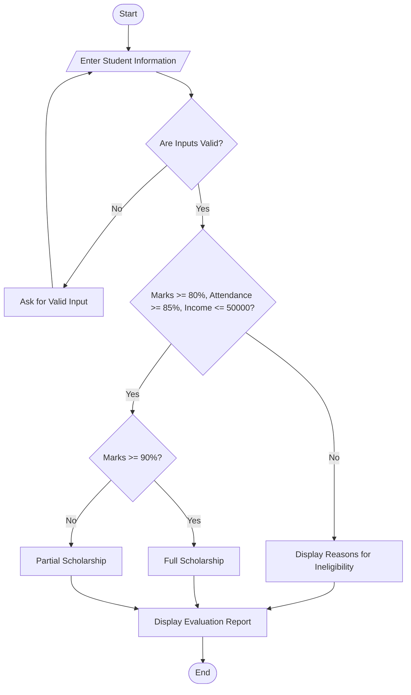
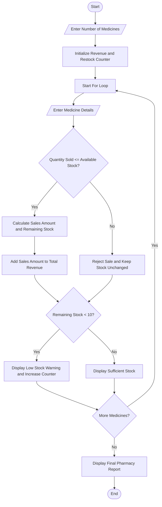

# Python Conditions and Loops Assessment

## 1. Project Overview

This repository contains two separate Python applications developed for the Python Conditions and Loops assessment. Both applications demonstrate how programming concepts can solve practical business problems.

- **Task 1 – Student Scholarship Eligibility System:** Evaluates scholarship eligibility using academic marks, attendance, and monthly family income.
- **Task 2 – Smart Pharmacy Inventory & Sales Management System:** Processes medicine sales, updates stock, calculates revenue, and identifies medicines requiring restocking.

## 2. Project Structure

```text
python-conditions-loops-assessment/
├── student_scholarship_system.py
├── pharmacy_inventory_system.py
└── README.md
```

## 3. Task 1 – Student Scholarship Eligibility System

**Source File:** `student_scholarship_system.py`

### Purpose

This application collects a student's name, academic marks, attendance percentage, and monthly family income. It checks the eligibility criteria and displays a complete scholarship evaluation report.

### Scholarship Eligibility Rules

A student must satisfy all three conditions:

| Requirement | Eligibility Condition |
|---|---|
| Academic Marks | 80% or above |
| Attendance | 85% or above |
| Monthly Family Income | Rs. 50,000 or less |

Scholarship decisions:

| Academic Marks | Scholarship |
|---|---|
| 90% or above | Full Scholarship |
| 80% to below 90% | Partial Scholarship |

If any requirement is not satisfied, the application displays the reasons for ineligibility.

### Visual Flowchart



### Python Concepts Used

- `input()` and `print()`
- Variables and meaningful variable names
- `if`, `elif`, and `else`
- Comparison operators
- `while` loops for input validation
- `for` loop for displaying multiple reasons
- Lists to store ineligibility reasons
- Functions
- Exception handling using `try` and `except`

### Sample Execution

```text
STUDENT SCHOLARSHIP ELIGIBILITY SYSTEM

Enter student name: Ali
Enter academic marks percentage: 92
Enter attendance percentage: 90
Enter monthly family income (Rs.): 40000

SCHOLARSHIP EVALUATION REPORT

Student Name          : Ali
Academic Marks        : 92.00%
Attendance            : 90.00%
Monthly Family Income : Rs. 40,000.00

Eligibility Status    : Eligible
Scholarship Decision  : Full Scholarship

Congratulations! You have met all scholarship requirements.
```

### Test Cases – Task 1

| Test ID | Marks | Attendance | Monthly Income | Expected Result |
|---|---:|---:|---:|---|
| SCH-01 | 95% | 90% | Rs. 40,000 | Full Scholarship |
| SCH-02 | 85% | 88% | Rs. 45,000 | Partial Scholarship |
| SCH-03 | 80% | 85% | Rs. 50,000 | Partial Scholarship |
| SCH-04 | 79% | 90% | Rs. 40,000 | Not Eligible – Low Marks |
| SCH-05 | 90% | 84% | Rs. 40,000 | Not Eligible – Low Attendance |
| SCH-06 | 90% | 90% | Rs. 60,000 | Not Eligible – High Income |
| SCH-07 | 70% | 80% | Rs. 60,000 | All Three Reasons Displayed |
| SCH-08 | 90% | 90% | Rs. 50,000 | Full Scholarship |

### Input Validation Test Cases

| Test ID | Invalid Input | Expected Result |
|---|---|---|
| SCH-V01 | Marks = abc | Ask for valid number |
| SCH-V02 | Attendance = 105 | Reject percentage |
| SCH-V03 | Income = -500 | Reject negative income |
| SCH-V04 | Empty student name | Ask for name again |

---

## 4. Task 2 – Smart Pharmacy Inventory & Sales Management System

**Source File:** `pharmacy_inventory_system.py`

### Purpose

This application manages medicine inventory and calculates daily pharmacy sales revenue.

It asks how many different medicines need to be processed and collects the following information for each medicine:

- Medicine name
- Available stock
- Price per unit
- Quantity sold

The program checks stock availability before processing a sale.

If the requested quantity is available, the sale is completed and the remaining stock is calculated.

If the requested quantity is greater than available stock, the sale is rejected.

A low-stock warning is displayed whenever remaining stock is below 10 units.

### Business Calculations

- Sales Amount = Quantity Sold × Price Per Unit
- Remaining Stock = Available Stock − Quantity Sold
- Total Revenue = Sum of Successful Sales
- Restocking Count = Number of Medicines with Remaining Stock Below 10

### Visual Flowchart



### Python Concepts Used

- `input()` and `print()`
- Variables and arithmetic operators
- `for` loop
- `range()` function
- `if` and `else` conditions
- `while` loops for input validation
- Counter to count medicines requiring restocking
- Accumulator to calculate total revenue
- Functions
- Exception handling using `try` and `except`

### Sample Execution

```text
SMART PHARMACY INVENTORY & SALES MANAGEMENT

How many different medicines do you want to process? 2

--- Medicine 1 of 2 ---

Enter medicine name: Panadol
Enter available stock: 50
Enter price per unit: 20
Enter quantity to sell: 45

Sale processed successfully.

Medicine Name       : Panadol
Quantity Sold       : 45
Sales Amount        : Rs. 900
Remaining Stock     : 5 units

LOW-STOCK WARNING: This medicine needs restocking.

--- Medicine 2 of 2 ---

Enter medicine name: Brufen
Enter available stock: 30
Enter price per unit: 15
Enter quantity to sell: 10

Sale processed successfully.

Medicine Name       : Brufen
Quantity Sold       : 10
Sales Amount        : Rs. 150
Remaining Stock     : 20 units

Stock level is sufficient.

DAILY PHARMACY REPORT

Total Medicines Processed  : 2
Total Pharmacy Revenue     : Rs. 1,050
Medicines Requiring Restock: 1
```

### Test Cases – Task 2

| Test ID | Medicine | Available Stock | Price | Quantity Sold | Expected Result |
|---|---|---:|---:|---:|---|
| PHY-01 | Panadol | 50 | 20 | 20 | Successful Sale, Rs. 400 Revenue |
| PHY-02 | Brufen | 15 | 15 | 15 | Sale Successful, Low Stock |
| PHY-03 | Syrup | 5 | 120 | 8 | Sale Rejected |
| PHY-04 | Vitamin C | 20 | 10 | 0 | Zero Quantity Sale |
| PHY-05 | Medicine X | 10 | 50 | 1 | Remaining Stock 9, Warning |
| PHY-06 | Medicine Y | 20 | 25 | 10 | Remaining Stock 10, No Warning |

### Input Validation Test Cases

| Test ID | Invalid Input | Expected Result |
|---|---|---|
| PHY-V01 | Number of medicines = abc | Ask for valid number |
| PHY-V02 | Number of medicines = 0 | Reject zero |
| PHY-V03 | Available stock = -5 | Reject negative stock |
| PHY-V04 | Price = 0 or -10 | Reject invalid price |
| PHY-V05 | Quantity sold = -2 | Reject negative quantity |
| PHY-V06 | Empty medicine name | Ask for medicine name again |

### Example Revenue Calculation

| Medicine | Quantity Sold | Price | Sales Amount |
|---|---:|---:|---:|
| Panadol | 45 | Rs. 20 | Rs. 900 |
| Brufen | 10 | Rs. 15 | Rs. 150 |
| **Total** | | | **Rs. 1,050** |

Final Results:

- Total Medicines Processed: 2
- Total Pharmacy Revenue: Rs. 1,050
- Medicines Requiring Restocking: 1

---

## 5. Requirements

- Python 3.8 or later
- Visual Studio Code, PyCharm, or IDLE
- No external Python libraries required

## 6. How to Run the Programs

First, download or clone this repository and open the project folder in VS Code.

### Run Task 1 – Scholarship System

```bash
python student_scholarship_system.py
```

### Run Task 2 – Pharmacy System

```bash
python pharmacy_inventory_system.py
```

If your computer uses `python3`, replace `python` with `python3`.

---

## 7. GitHub Setup

Create a GitHub repository with this name:

```text
python-conditions-loops-assessment
```

Use the following commands in the project folder:

```bash
git init
git add .
git commit -m "Complete Python conditions and loops assessment"
git branch -M main
git remote add origin https://github.com/YOUR-USERNAME/python-conditions-loops-assessment.git
git push -u origin main
```

Replace `YOUR-USERNAME` with your GitHub username.

---

## 8. Conclusion

This assessment demonstrates the practical use of conditional statements and loop structures in Python.

The Student Scholarship Eligibility System uses conditional statements to evaluate student eligibility, while the Smart Pharmacy Inventory System uses loops, counters, and accumulators to manage medicine sales and inventory.

Both applications include input validation, meaningful variables, functions, and proper output reports.


